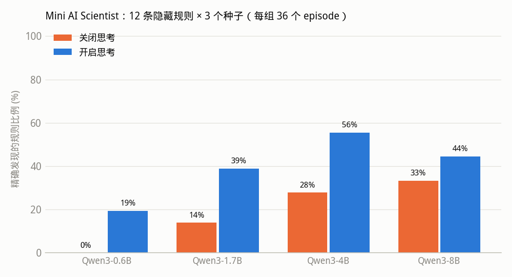

# Mini AI Scientist：让开源小模型做可验证的科学发现

让开源模型（Qwen3 0.6B–8B）自己**提出假设 → 设计实验 → 调用 Python 分析 → 修正假设**，发现一台黑盒机器的隐藏规则。
输入空间有限（`a, b ∈ [0, 20]`，共 441 个输入），提交的规则在全部输入上做精确等价验证，**无需 LLM 裁判**。

本仓库是[魔搭紫皮书（ms-cookbook）](https://github.com/modelscope/ms-cookbook)第 34 章「Mini AI Scientist」的配套代码。

- 主 Notebook：[`mini_ai_scientist.ipynb`](mini_ai_scientist.ipynb)（保留真实运行输出；魔搭 Notebook 单卡 GPU 可跑通）
- 核心代码：[`mini_scientist/`](mini_scientist/)
- 完整实验结果：[`results/sweep/summary.md`](results/sweep/summary.md)（17 个配置 × 36 个 episode，逐轮记录在同目录 JSONL 中）



| 模型 | 关闭思考 | 开启思考 |
|---|---|---|
| Qwen3-0.6B | 0/36 | 7/36 |
| Qwen3-1.7B | 5/36 | 14/36 |
| Qwen3-4B | 10/36 | 20/36 |
| Qwen3-8B | 12/36 | 16/36 |

## 目录

```
mini_scientist/
  lab.py        隐藏规则实验室：12 条规则 × 3 个难度等级，AST 白名单沙箱，441 点精确验证
  agent.py      Agent 循环：experiment / compute / check / submit 四个工具 + 实验记录本 + 可选提交关卡
  backend.py    推理后端：vLLM（推荐，支持 thinking）与 transformers
  baseline.py   非 LLM 参照：随机实验 + 穷举约 1.2 万条候选规则
scripts/
  test_lab.py          无需 GPU 的单元测试
  run_eval.py          单个模型在全部规则上的评测
  run_sweep.sh         模型规模 × 思考模式 × 提交关卡 × 工具消融 的完整扫描（单卡 A100 约 4 小时）
  analyze.py           汇总结果表与图
  build_notebook.py    生成 Notebook（不含输出）
  execute_notebook.py  从头执行 Notebook 并保存真实输出
  strip_notebook_logs.py  去掉保存输出中的 vLLM 日志（含本机路径）
  render_cells.py / make_flowchart.py  生成文档配图
```

## 快速开始

环境：Python 3.11，`vllm==0.11.0`（自带 torch 2.8.0+cu128），`transformers>=4.56,<5`，NVIDIA 驱动支持 CUDA 12.8+，单卡 ≥24GB 显存。

```bash
pip install "vllm==0.11.0" "transformers>=4.56,<5" modelscope pandas matplotlib
python scripts/test_lab.py                                   # 应输出 all lab tests passed
USE_MODELSCOPE=1 python scripts/run_eval.py --backend vllm --think --model Qwen/Qwen3-4B --seeds 3
python scripts/analyze.py results
```

`USE_MODELSCOPE=1` 表示从魔搭下载模型权重；设为 `0` 则使用 Hugging Face 缓存。

## 许可

代码以 [Apache-2.0](LICENSE) 发布。所用模型 Qwen3 / Qwen2.5 与推理框架 vLLM 均为 Apache-2.0。
